# 🎯 나만의 터미널 퀴즈 게임

> 입학연수 미션 「컴퓨터에게 명령 내리는 말(파이썬) 처음 배우기」 결과물
> Python 표준 라이브러리만으로 만든 콘솔 퀴즈 게임입니다. (Python 3.10+)

---

## 📌 프로젝트 개요

터미널에서 실행하는 퀴즈 게임입니다. 메뉴에서 번호를 골라 퀴즈를 풀고, 새 퀴즈를 추가하고, 목록과 최고 점수를 확인할 수 있습니다.
퀴즈와 최고 점수는 `state.json`에 저장되므로 프로그램을 종료했다가 다시 실행해도 유지됩니다.
보너스는 랜덤 출제(5.1)와 문제 수 선택(5.2)을 구현했고, 힌트·삭제·히스토리는 미구현입니다.

- **언어/환경:** Python 3.10 이상, 외부 라이브러리 없음 (`json`, `os`, `random`, `sys`, `pathlib`만 사용)
- **구조:** `Quiz`(문제 1개) / `QuizGame`(메뉴·출제·저장 등 전체 흐름) 두 클래스
- **핵심 학습 요소:** 입출력, 조건문/반복문, 클래스, JSON 파일 입출력, `try/except` 예외 처리, Git/GitHub

## 💡 퀴즈 주제 선정 이유

- **주제:** 파이썬 & 개발 입문 기초
- **선정 이유:** > 이번 미션은 파이썬을 배우기 위한 과정이므로 파이썬에 관한 퀴즈를 작성하여 개념을 정리하고자 함.
  

##  git hub URL: https://github.com/L011235/Mission-1-2-Quiz-Game

## 🚀 실행 방법

```bash
# 1. 저장소 복제
git clone https://github.com/L011235/Mission-1-2-Quiz-Game.git
cd Mission-1-2-Quiz-Game

# 2. 실행 (Python 3.10 이상)
python main.py        # macOS/Linux에서는 python3 main.py
```

- 처음 실행할 때 `state.json`이 없으면 기본 퀴즈 7개로 시작하고 파일을 자동으로 만듭니다.
- 입력 중 `Ctrl+C`(또는 입력 종료)를 해도 안내 메시지와 함께 저장 후 안전하게 종료됩니다.

## ✨ 기능 목록

| 메뉴 | 기능 | 설명 |
|---|---|---|
| 1 | 퀴즈 풀기 | **풀 문제 수를 선택**하고, 문제를 **랜덤 순서**로 출제. 정답/오답 안내(오답이면 정답 공개), 결과 점수 표시, 최고 점수 갱신 |
| 2 | 퀴즈 추가 | 문제, 선택지 4개, 정답 번호(1~4)를 입력해 등록하고 즉시 파일에 저장 |
| 3 | 퀴즈 목록 | 등록된 퀴즈 목록 확인 (없으면 안내 메시지) |
| 4 | 점수 확인 | 최고 점수 확인 (아직 풀지 않았다면 안내 메시지) |
| 5 | 종료 | 데이터를 저장하고 종료 |

**공통 입력/예외 처리**
- 입력 앞뒤 공백 제거, 숫자가 아닌 입력 / 빈 입력 / 허용 범위 밖 숫자 → 안내 후 재입력
- `KeyboardInterrupt`, `EOFError` → 안내 메시지 후 저장하고 종료
- `state.json` 없음 → 기본 퀴즈로 시작 / 손상됨 → 안내 후 기본 퀴즈로 초기화 (손상 파일은 `state.json.corrupt`로 보관)
- 저장은 임시 파일(`state.json.tmp`)에 먼저 쓴 뒤 교체해서, 저장 도중 파일이 깨지지 않도록 함

**보너스**
- [x] 랜덤 출제 (`random.sample`)
- [x] 문제 수 선택


## 📁 파일 구조


```text
.
├── main.py        # 프로그램 본체 (Quiz, QuizGame 클래스)
├── state.json     # 퀴즈 목록과 최고 점수 저장 파일 (실행 시 생성/갱신)
├── .gitignore     # Git 추적 제외 목록
├── README.md      # 프로젝트 설명서
└──images/         # 스크린샷 파일 모음 폴더
```

## 🗂 데이터 파일 설명 (`state.json`)

프로젝트 루트(`main.py`와 같은 폴더)에 UTF-8 인코딩으로 저장됩니다.

```json
{
  "quizzes": [
    {
      "question": "파이썬(Python)을 만든 사람은?",
      "choices": ["귀도 반 로섬", "리누스 토르발스", "비야네 스트롭스트룹", "제임스 고슬링"],
      "answer": 1
    }
  ],
  "best_score": 80,
  "best_correct": 4,
  "best_total": 5
}
```

| 키 | 타입 | 설명 |
|---|---|---|
| `quizzes` | list[dict] | 퀴즈 목록 |
| `quizzes[].question` | str | 문제 |
| `quizzes[].choices` | list[str] | 선택지 4개 |
| `quizzes[].answer` | int | 정답 번호 (1~4) |
| `best_score` | int / null | 최고 점수 (100점 만점). 아직 풀지 않았으면 `null` |
| `best_correct` | int / null | 최고 점수를 냈을 때 맞힌 문제 수 |
| `best_total` | int / null | 최고 점수를 냈을 때 전체 문제 수 |

### 💾 JSON 저장 방식의 한계와 대안

JSON은 텍스트 형식이라 사람이 읽고 고치기 쉽고 구현이 간단합니다. 다만 데이터가 아주 많아지면 한계가 있습니다.

- **전체 읽기/쓰기:** 퀴즈 하나만 필요해도 파일 전체를 읽어 메모리에 올리고, 저장할 때도 매번 전체를 다시 씁니다.
- **용량과 파싱 비용:** 텍스트라서 용량이 크고, 읽을 때 파싱 시간이 듭니다.
- **부분 검색/수정, 동시 접근에 불리**합니다.

직접 측정해 보니(환경에 따라 다름) 퀴즈 1,000개의 로딩은 약 2ms로 체감 차이가 없었고, 10만 개는 약 0.24초(16MB), 100만 개는 약 2.2초(161MB)였습니다. 이 프로그램은 퀴즈가 수십 개 수준이라 JSON의 단점이 거의 드러나지 않고, 간단함과 가독성이 더 큰 장점이어서 JSON을 선택했습니다.

| 방식 | 장점 | 단점 | 적합한 경우 |
|---|---|---|---|
| **JSON** (현재) | 읽기 쉽고 구현이 간단함, 표준 라이브러리 | 전체 읽기/쓰기, 대용량에 불리 | 소규모, 학습용 |
| **pickle** (바이너리) | 용량이 JSON의 절반 정도, 대용량에서 더 빠름 | 사람이 읽을 수 없음, 파이썬 전용, 믿을 수 없는 파일을 열면 악성 코드 실행 위험 | 빠른 임시 저장 (주의 필요) |
| **SQLite** (`sqlite3`) | 필요한 행만 조회/수정 가능 (100만 건에서도 1건 조회 약 0.14ms) | SQL 학습 필요, 구조가 복잡, 파일을 직접 열어 볼 수 없음 | 대용량, 검색 필요 |
| **CSV** | 표 형태에는 간단함 | 선택지 4개 같은 목록(중첩 구조)을 담기 불편 | 단순한 표 데이터 |


> 파일 형식이 깨지면 다음 실행 때 안내 메시지와 함께 기본 퀴즈로 복구됩니다.


## 플로차트
### 전체흐름도
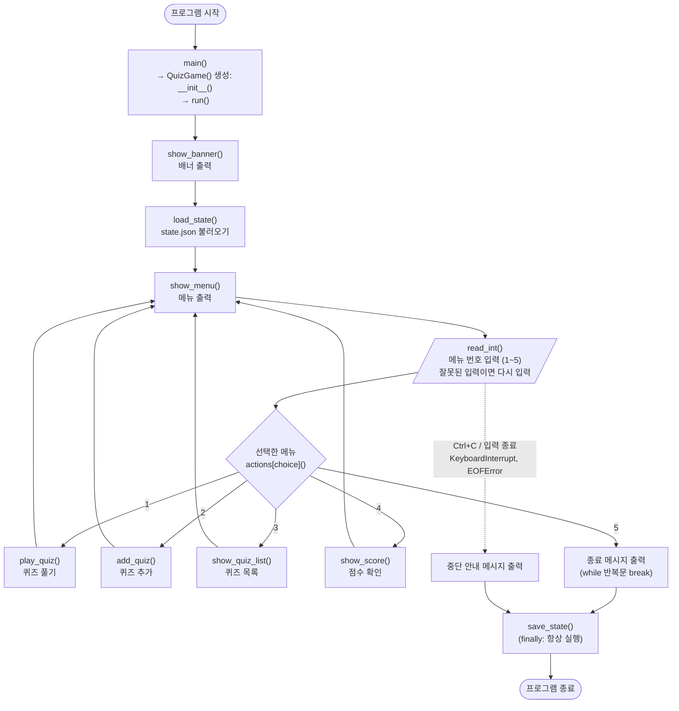
### 시작시 데이터 로드
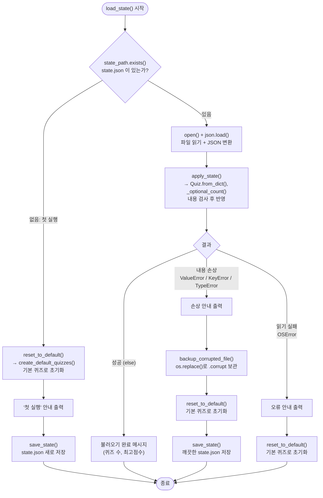
### 퀴즈 풀기
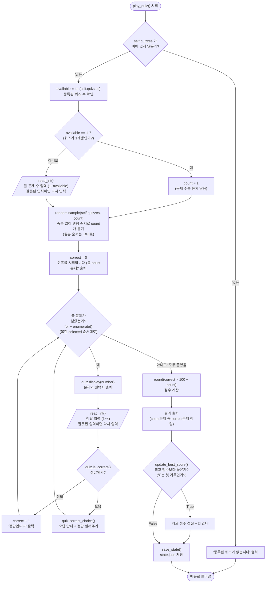
### 퀴즈 추가
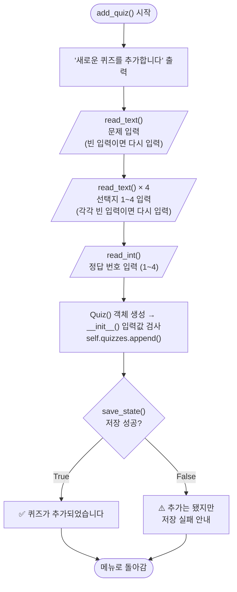
## 📸 제출 스크린샷

### 1. 개발 환경
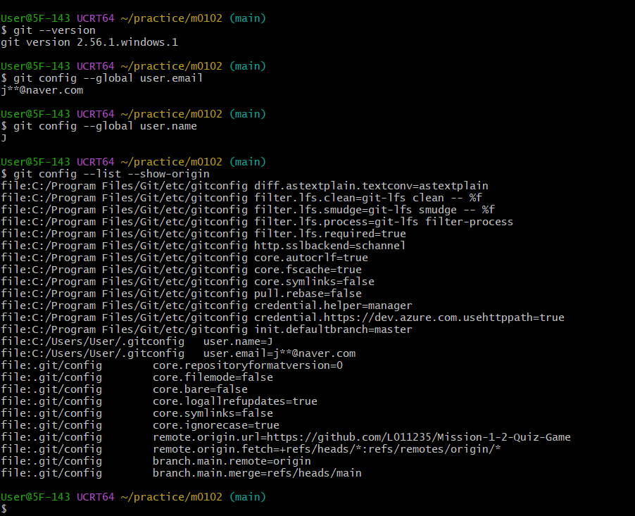
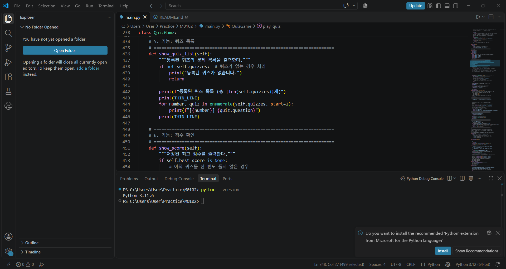

### 2. Git 초기 설정
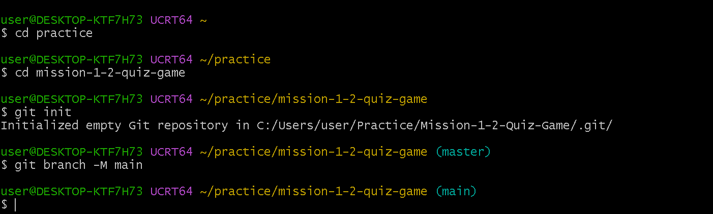
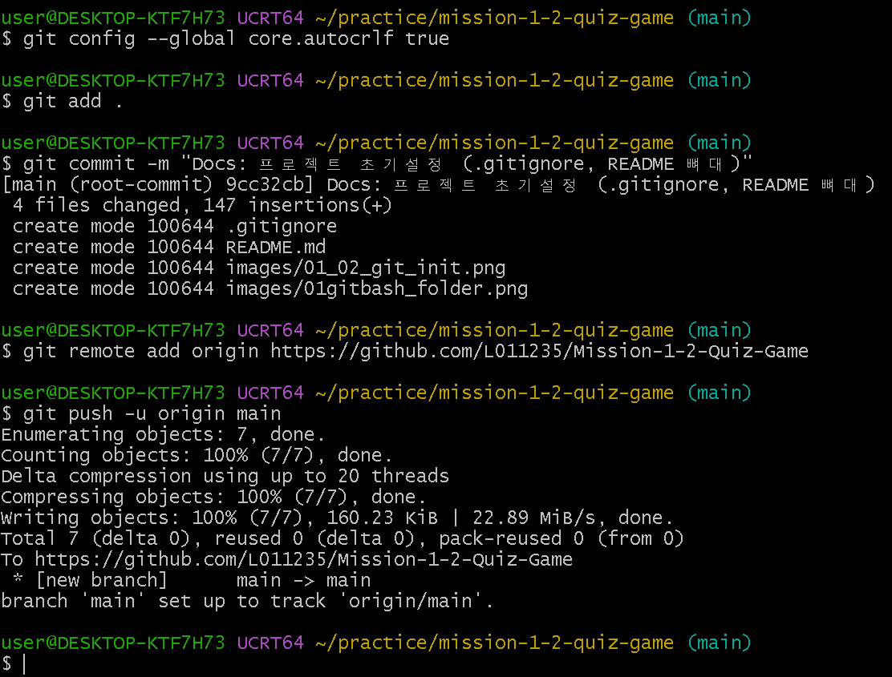
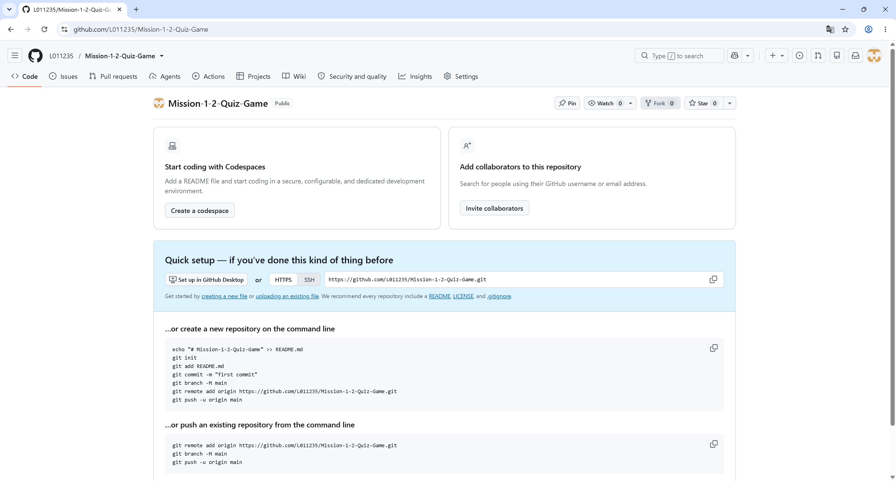

### 3. 프로그램 실행 결과
**최고 점수 확인 (재실행 후에도 저장된 데이터 유지)**
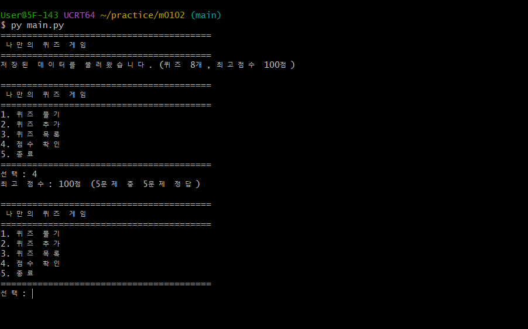

**퀴즈 풀기 (문제 수 선택, 랜덤 출제, 오답 안내)**
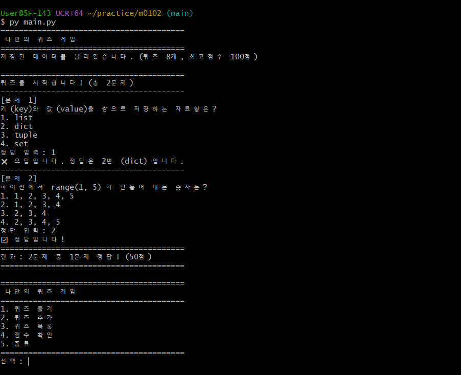

**퀴즈 추가**
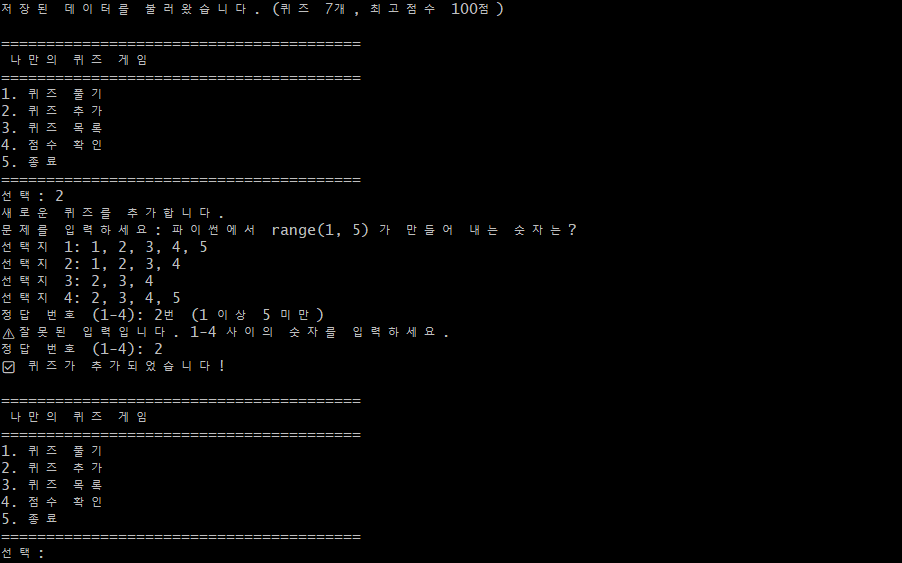

**퀴즈 목록**
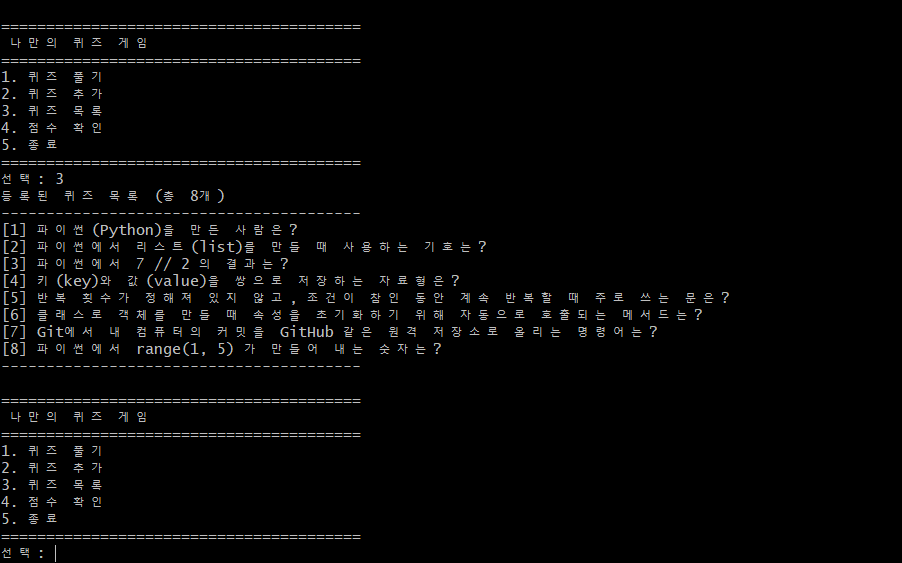

**입력 예외 처리 (범위 밖, 문자, 빈 입력, Ctrl+C)**
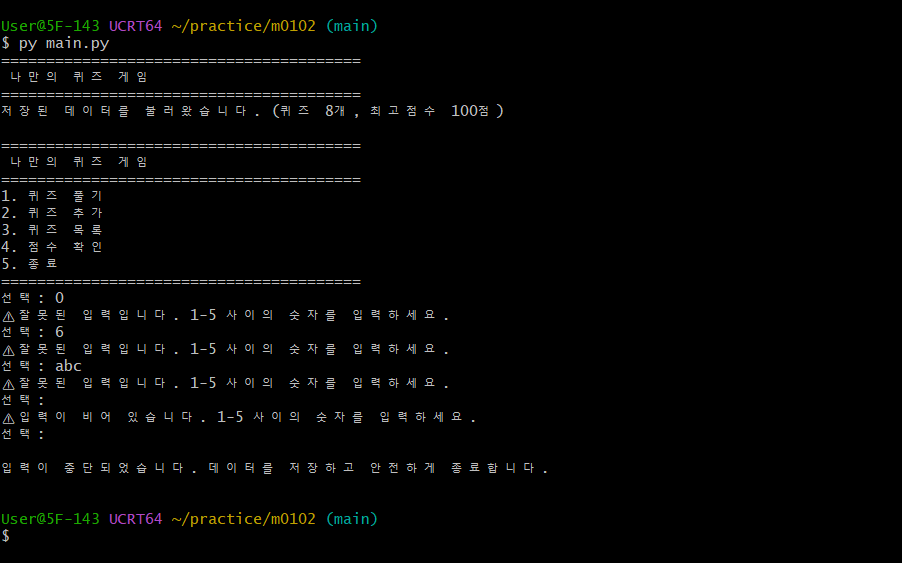

### 4. Git 이력
**커밋 로그 (`git log --oneline --graph`)**
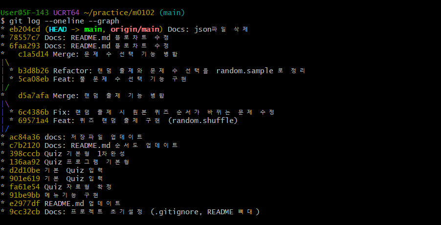

**clone**
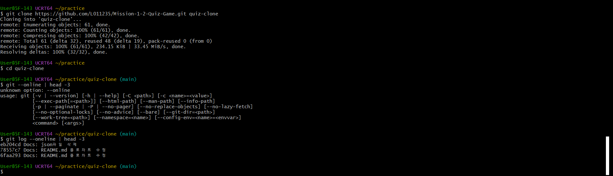

**pull**
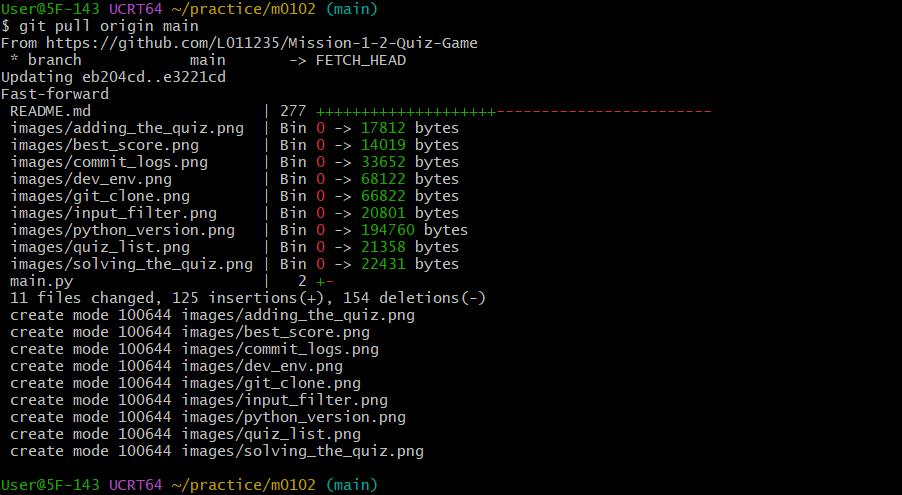

---


# ✅ 미션 TODO 리스트

> **현황:** `main.py` 코드는 필수 기능 전부 + 보너스 2개(랜덤 출제, 문제 수 선택)까지 **완성**된 상태입니다.
> 남은 일은 **Git/GitHub 작업, README, 제출물**입니다. 제출 전까지 하나씩 체크하세요.
> (최종 제출 때는 이 섹션을 지우거나 "개발 기록"으로 남겨도 됩니다.)

## 🟢 이미 끝난 것 (main.py 기준)
- [x] 메뉴 출력, 번호 선택, 종료, 잘못된 입력 처리 (미션 4.2)
- [x] 공통 입력/예외 처리: 공백 제거 / 변환 실패 / 범위 밖 / 빈 입력 / `Ctrl+C`·`EOFError` (4.3)
- [x] `Quiz` 클래스 + 입력값 검사 (4.4)
- [x] 기본 퀴즈 7개 (5개 이상 조건 충족) (4.5)
- [x] 퀴즈 풀기 · 퀴즈 추가 · 퀴즈 목록 · 점수 확인 (4.6~4.9)
- [x] `QuizGame` 클래스 (4.10)
- [x] `state.json` 저장/불러오기, 없음·손상 처리 (4.11)
- [x] 보너스 5.1 랜덤 출제, 5.2 문제 수 선택

## 🔴 해야 할 것


### 1. Git 저장소 설정 (`init`, `add`, `commit`, `push`)
- [x] Python 버전, Git 사용자 설정 확인 (`python --version`, `git config --global user.name` / `user.email`) ← 스크린샷 필요
- [x] GitHub에 새 저장소 생성
- [x] 로컬 폴더에서 `git init` 및 원격 연결 (`git remote add origin ...`)
- [x] `.gitignore` 작성 (예: `__pycache__/`, `state.json.tmp`, `state.json.corrupt`)
- [x] 이 README.md 배치


### 2. 저장소 복제 실습 (`clone`, `pull`)
- [x] 다른 위치에 `git clone`으로 저장소 복제
- [x] 복제본에서 README 등 간단히 수정 → `commit` → `push`
- [x] 원래 작업 폴더에서 `git pull`로 변경사항 반영 확인

### 3. 최종 점검
- [x] 의미 있는 커밋 10개 이상 / 브랜치 생성·병합 기록 / `clone`·`pull` 사용 기록
- [x] Git 명령어 7종 모두 사용: `init` `add` `commit` `push` `pull` `checkout` `clone`
- [x] GitHub 저장소에 최신 코드와 README가 올라가 있음
- [x] `state.json`을 올릴지 결정 (올린다면 기본 데이터 상태로 깨끗하게) 안 올림.

### 4. 제출물
- [x] GitHub 저장소 URL 
- [x] 개발 환경 스크린샷 (VSCode, Python 버전, Git 설정)
- [x] 실행 결과 스크린샷 (퀴즈 추가, 목록, 플레이, 점수)
- [x] `git log --oneline --graph` 결과 스크린샷
