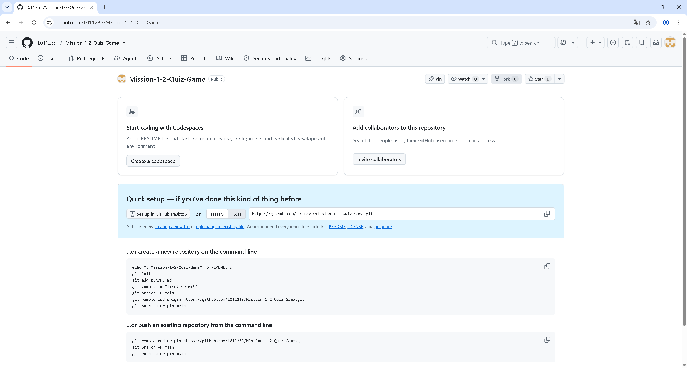
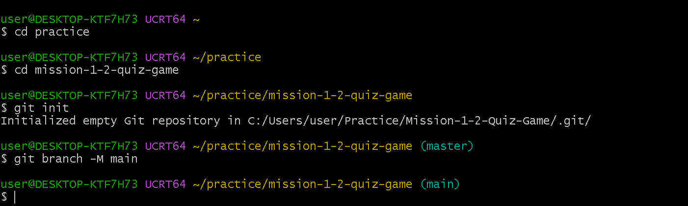

# 나만의 퀴즈 게임

## 프로젝트 개요
터미널(콘솔)에서 동작하는 Python 퀴즈 게임입니다.
메뉴에서 번호를 골라 퀴즈를 풀고, 새 퀴즈를 추가·삭제하고, 목록과 최고 점수, 플레이 기록을 확인할 수 있습니다.
퀴즈와 점수, 기록은 `state.json` 파일에 저장되므로 프로그램을 종료했다가 다시 실행해도 유지됩니다.

- Python 기본 문법 + 클래스(`Quiz`, `QuizGame`)로 역할을 분리했습니다.
- 외부 라이브러리 없이 표준 라이브러리(`json`, `os`, `random`, `sys`, `datetime`, `pathlib`)만 사용합니다.
- 보너스 과제 5개(랜덤 출제, 문제 수 선택, 힌트, 퀴즈 삭제, 점수 기록)를 모두 구현했습니다.

## 퀴즈 주제와 선정 이유
**주제: 파이썬 & 개발 입문 기초**

이 미션에서 배우는 내용(자료형, 반복문, 클래스, Git)을 퀴즈로 만들면 문제를 쓰면서 개념을 다시 정리할 수 있어서 선택했습니다.
(※ 본인이 정한 주제와 이유로 바꿔서 작성하세요.)

## 실행 방법
Python 3.10 이상이 필요합니다.

## git init
```text
user@DESKTOP-KTF7H73 UCRT64 ~
$ cd practice

user@DESKTOP-KTF7H73 UCRT64 ~/practice
$ cd mission-1-2-quiz-game

user@DESKTOP-KTF7H73 UCRT64 ~/practice/mission-1-2-quiz-game
$ git init
Initialized empty Git repository in C:/Users/user/Practice/Mission-1-2-Quiz-Game/.git/

user@DESKTOP-KTF7H73 UCRT64 ~/practice/mission-1-2-quiz-game (master)
$ git branch -M main

user@DESKTOP-KTF7H73 UCRT64 ~/practice/mission-1-2-quiz-game (main)
$
```
#### 스크린샷




### 뼈대 업로드
```bash

git config --global core.autocrlf true
git add .
git commit -m "Docs: 프로젝트 초기설정 (.gitignore, README 뼈대)"
git remote add origin https://github.com/L011235/Mission-1-2-Quiz-Game
git push -u origin main
```
#### 실행결과
```text
user@DESKTOP-KTF7H73 UCRT64 ~/practice/mission-1-2-quiz-game (main)
$ git add .
warning: in the working copy of '.gitignore', LF will be replaced by CRLF the next time Git touches it
warning: in the working copy of 'README.md', LF will be replaced by CRLF the next time Git touches it

user@DESKTOP-KTF7H73 UCRT64 ~/practice/mission-1-2-quiz-game (main)
$ ^C

user@DESKTOP-KTF7H73 UCRT64 ~/practice/mission-1-2-quiz-game (main)
$ git config --global core.autocrlf true

user@DESKTOP-KTF7H73 UCRT64 ~/practice/mission-1-2-quiz-game (main)
$ git add .

user@DESKTOP-KTF7H73 UCRT64 ~/practice/mission-1-2-quiz-game (main)
$ git commit -m "Docs: 프로젝트 초기설정 (.gitignore, README 뼈대)"
[main (root-commit) 9cc32cb] Docs: 프로젝트 초기설정 (.gitignore, README 뼈대)
 4 files changed, 147 insertions(+)
 create mode 100644 .gitignore
 create mode 100644 README.md
 create mode 100644 images/01_02_git_init.png
 create mode 100644 images/01gitbash_folder.png

user@DESKTOP-KTF7H73 UCRT64 ~/practice/mission-1-2-quiz-game (main)
$ git remote add origin https://github.com/L011235/Mission-1-2-Quiz-Game

user@DESKTOP-KTF7H73 UCRT64 ~/practice/mission-1-2-quiz-game (main)
$ git push -u origin main
Enumerating objects: 7, done.
Counting objects: 100% (7/7), done.
Delta compression using up to 20 threads
Compressing objects: 100% (7/7), done.
Writing objects: 100% (7/7), 160.23 KiB | 22.89 MiB/s, done.
Total 7 (delta 0), reused 0 (delta 0), pack-reused 0 (from 0)
To https://github.com/L011235/Mission-1-2-Quiz-Game
 * [new branch]      main -> main
branch 'main' set up to track 'origin/main'.

user@DESKTOP-KTF7H73 UCRT64 ~/practice/mission-1-2-quiz-game (main)
```

```bash
git clone <저장소 URL>
cd <저장소 폴더>
python main.py        # macOS/Linux에서 python3 main.py
```

## 기능 목록
| 메뉴 | 기능 |
| --- | --- |
| 1. 퀴즈 풀기 | 풀 문제 수를 고르면 그만큼 **무작위 순서**로 출제. 정답/오답 안내, 결과(100점 만점) 표시, 최고 점수 갱신, 기록 저장 |
| 2. 퀴즈 추가 | 문제, 선택지 4개, 정답 번호, (선택) 힌트를 입력받아 등록하고 파일에 저장 |
| 3. 퀴즈 목록 | 등록된 퀴즈의 문제 목록 확인 |
| 4. 점수 확인 | 최고 점수 확인 (아직 안 풀었다면 안내 메시지) |
| 5. 퀴즈 삭제 | 목록에서 번호를 골라 삭제(확인 질문 후 파일에 반영) |
| 6. 점수 기록 | 날짜/시간, 푼 문제 수, 맞힌 수, 힌트 사용 수, 점수 확인 (최근 20회 표시) |
| 7. 종료 | 프로그램 종료 |

**보너스 과제 구현 현황**
| 보너스 | 구현 방법 |
| --- | --- |
| 5.1 랜덤 출제 | `random.sample` 로 문제 순서를 섞음 (저장된 퀴즈 순서는 그대로) |
| 5.2 문제 수 선택 | 퀴즈 풀기 시작 전에 풀 문제 수(1~전체)를 입력 |
| 5.3 힌트 | `Quiz.hint` 속성 추가. 풀이 중 `h` 입력 시 힌트 표시. 힌트를 쓴 문제는 정답이어도 0.5점만 인정(만점 1점 기준) |
| 5.4 퀴즈 삭제 | 번호 선택 → `y/n` 확인 → 삭제 후 `state.json` 에 즉시 반영 |
| 5.5 점수 기록 | 매 판의 기록을 `history` 에 누적 저장 |

**점수 계산 규칙**: 문제당 만점 1점. 힌트 없이 정답 = 1점, 힌트 쓰고 정답 = 0.5점, 오답 = 0점.
최종 점수 = (얻은 점수 합 ÷ 푼 문제 수) × 100 을 반올림한 값입니다.

**안전 처리**
- 숫자 입력: 앞뒤 공백 제거, 숫자가 아님/범위 밖/빈 입력이면 안내 후 다시 입력
- `Ctrl+C`, 입력 스트림 종료(EOF): 안내 메시지 출력 후 저장하고 정상 종료
- `state.json`이 없으면 기본 퀴즈로 시작, 손상되었으면 안내 후 기본 데이터로 복구
  (손상된 파일은 `state.json.corrupt`로 보관)
- 힌트/기록 기능이 생기기 전에 만든 예전 형식의 `state.json` 도 그대로 읽을 수 있음

## 파일 구조
```
.
├── main.py        # Quiz, QuizGame 클래스와 프로그램 진입점
├── state.json     # 퀴즈 + 최고 점수 + 플레이 기록 저장 파일 (첫 실행 시 자동 생성)
├── README.md
├── .gitignore
└── docs/
    └── screenshots/   # 실행 화면 캡처 (menu.png, play.png, add_quiz.png, score.png)
```

## 데이터 파일 설명 (state.json)
- 경로: 프로젝트 루트의 `state.json` (UTF-8 인코딩)
- 역할: 퀴즈 목록, 최고 점수, 플레이 기록을 저장해 프로그램을 다시 실행해도 유지
- 스키마:

```json
{
  "quizzes": [
    {
      "question": "파이썬(Python)을 만든 사람은?",
      "choices": ["귀도 반 로섬", "리누스 토르발스", "비야네 스트롭스트룹", "제임스 고슬링"],
      "answer": 1,
      "hint": "이름이 '귀'로 시작하는 네덜란드 출신 프로그래머예요."
    }
  ],
  "best_score": 100,
  "best_correct": 7,
  "best_total": 7,
  "history": [
    {
      "played_at": "2026-11-10 14:03:22",
      "total": 7,
      "correct": 7,
      "hints_used": 0,
      "score": 100
    }
  ]
}
```

| 필드 | 타입 | 설명 |
| --- | --- | --- |
| `quizzes` | list | 퀴즈 목록 |
| `quizzes[].question` | str | 문제 |
| `quizzes[].choices` | list[str] | 선택지 4개 |
| `quizzes[].answer` | int | 정답 번호 (1~4) |
| `quizzes[].hint` | str | 힌트. 빈 문자열이면 힌트 없음 (없는 파일이면 빈 문자열로 처리) |
| `best_score` | int \| null | 최고 점수(100점 만점). 아직 안 풀었으면 `null` |
| `best_correct` / `best_total` | int \| null | 최고 점수를 냈을 때의 정답 수 / 푼 문제 수 |
| `history` | list | 플레이 기록 (없는 파일이면 빈 목록으로 처리) |
| `history[].played_at` | str | 플레이한 날짜/시간 (`YYYY-MM-DD HH:MM:SS`) |
| `history[].total` | int | 푼 문제 수 |
| `history[].correct` | int | 맞힌 문제 수 |
| `history[].hints_used` | int | 힌트를 사용한 문제 수 |
| `history[].score` | int | 점수 (100점 만점) |
